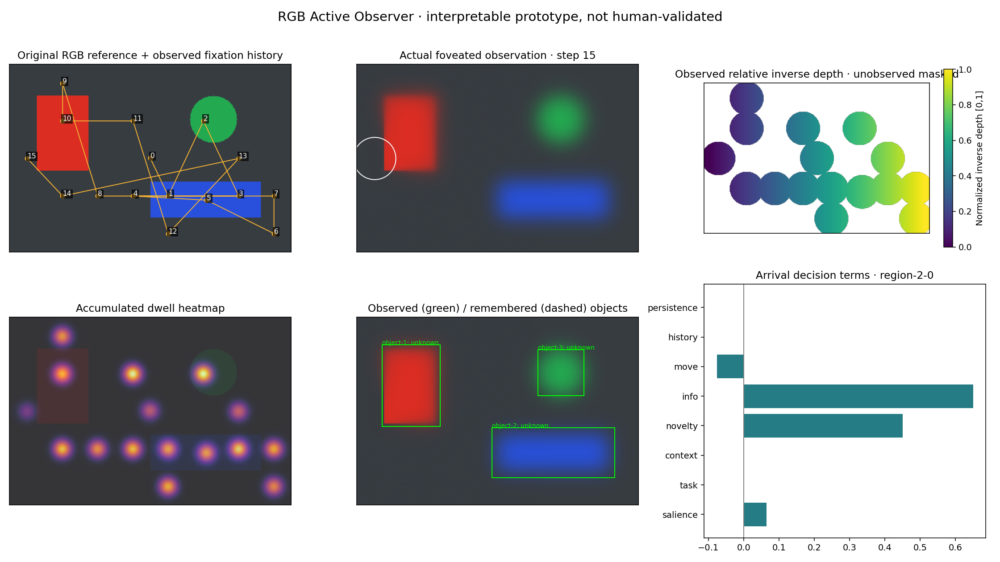

# RGB Active Observer

A new, independent Python implementation of the supplied **RGB-only Active Visual Observer v1.0** specification. It does not import or reuse Gaze Lab, its parameters, its controllers, or its empirical results.

This directory is self-contained inside the `feature/rgb-active-observer-v1` branch of `tamayowang-lab/single-view-image-rectification`. Existing repository files remain outside this directory. Work here, rather than in the parent project's Python environment.

## Run the observer and visualization

Python 3.11+; CPU; no pretrained weights or dataset download needed for the default demo:

```bash
cd rgb-active-observer
python -m venv .venv
# Linux / macOS
source .venv/bin/activate
# Windows instead: .venv\Scripts\activate
python -m pip install -e '.[test]'
active-observer run-one examples/synthetic.png \
  --depth examples/synthetic-depth.npz --out outputs/example
```

Open **`outputs/example/inspector.html`** directly in a browser. It contains everything needed offline: next/previous controls, play/pause, a fixation slider, foveated observations, object memory, signed utility contributions, relative-depth samples, candidate probabilities, heatmap, and JSON download. No server or account is required.

**`outputs/example/dashboard.png`** works without a browser. **`run.json`** records the configuration, seed, camera assumptions, each fixation, every candidate score, and object-memory snapshots. The initial fixation is step zero. A reference image and private estimator depth map are explicitly distinct from the observer's beliefs.



The image, depth ramp, and scanpath fixture are **synthetic engineering fixtures**, not empirical validation.

Other commands:

```bash
# No depth: no fabricated depth or meters
active-observer run-one examples/synthetic.png --out outputs/no-depth
# Dummy constant provider, explicitly marked uninformative
active-observer run-one examples/synthetic.png --depth constant --out outputs/dummy
# User starting point in zero-indexed pixels
active-observer run-one examples/synthetic.png --start 65 80 --seed 7 --out outputs/start
# Re-render any saved step as a PNG
active-observer visualize examples/synthetic.png outputs/example/run.json \
  --step 4 --out outputs/step-4.png
# Multiple independent image runs (distinct output filenames required)
active-observer run-batch examples/synthetic.png examples/synthetic-train.png \
  --config configs/quick-check.yaml --out outputs/batch
# Exercise the evaluation pipeline on explicitly invented reference scanpaths
active-observer evaluate examples/synthetic-manifest.json \
  --config configs/quick-check.yaml --out outputs/evaluation
python -m pytest -q
```

## What V1 implements

- Actual gaze-dependent RGB blur and eccentricity-based reliability. Supply `pixels_per_degree` in YAML for angular foveation; otherwise the run declares a pixel approximation.
- Peripheral color proto-objects plus a spatial exploration grid. Unknown space can be selected even when no object has been detected.
- Pluggable object and depth providers; one-to-one gated Hungarian association using position, category probabilities, and appearance.
- An uncertain object registry with observed/remembered/uncertain states, decay, familiarity, novelty, visits, soft return inhibition, relative depth, pseudo-3D centroids, extents and covariance proxies.
- Explicit salience, task, configured context priors, novelty, information proxy, movement cost, and history terms. Softmax selection and bounded lognormal durations use separate seeded streams. A bounded persistence bonus prevents hard gaze locks. `initial`, `stay`, `shift`, and `standby` modes and an explicit stop decision are logged.
- Fixed fixation/time budgets, optional explicit central target detection, batch runs, strict human-data contracts, held-out-image checks, baselines and ablations.

The utility is a heuristic, not exact Bayesian information gain:

```
U = .8 S + 1.3 T + .35 C + .45 N + .65 I - .5 M - .6 H + persistence
```

Terms are bounded to [0,1] before weighting. Persistence is at most 0.08 near the current fixation. Information uses uncertainty × novelty; depth dispersion can supply a small uncertainty term only after central depth evidence exists. Context priors default to empty; no undocumented category associations are inserted. Soft IOR decays with a 1200 ms time constant. Memory confidence decays with a configurable default 12000 ms constant. Dwell has an explicit 100–800 ms bound and lognormal variation. These are starting hypotheses, not fitted human parameters.

## Perception and leakage boundaries

The default detector is a lightweight connected-color-component provider applied to the **foveated image**. Its labels such as `red-region` are color descriptions, not category recognition. On ordinary photographs it is a baseline, not a high-accuracy semantic detector. Giving it a target such as “chair” does not create chair-recognition capability.

`ManualObjects` is a private test adapter: boxes and semantic labels leave the adapter only when their centers are in central vision, and returned geometry is clipped to the local crop. Changing a remote private label cannot change current beliefs or decisions.

The optional semantic detector below operates **only on the central crop**, with classical cues retained in the periphery. Its overlapping proto-objects are suppressed. It never receives full-resolution remote pixels for semantic inference.

A precomputed or pretrained depth map is a private sensor/reference output, not globally acquired world memory. Only valid samples in the intersection of an observed object and the central field update that object's depth. The inspector masks unobserved depth. The run's separately labeled `depth.reference` is available for reproducibility and debugging; the policy never receives that array.

Depth uses robust per-image inverse-depth normalization, valid masks, quality flags, dispersion, and a relative-range convention `1/(0.1+D)`. **It is not accurate meters.** Camera intrinsics, if omitted, use a canonical 60° pseudo-camera for visualization. XYZ and covariance are uncalibrated proxies, not full 3D reconstruction or object shape. RGB-D can implement the same provider contract later, but physical metric integration is outside V1.

## Optional pretrained adapters

```bash
python -m pip install -e '.[pretrained]'
active-observer run-one my-photo.jpg \
  --depth-checkpoint /path/to/local/depth-anything-compatible-checkpoint \
  --depth-kind inverse_depth \
  --detector-checkpoint /path/to/local/object-detector-checkpoint \
  --revision main --out outputs/photo
```

Adapters use Hugging Face `AutoImageProcessor`, `AutoModelForDepthEstimation` and `AutoModelForObjectDetection`, on CPU. Checkpoint architecture must be compatible with those APIs. Local files are required by default. `--allow-model-download` explicitly permits downloading a named model. Prefer a pinned revision for reproducibility. Declare whether the depth checkpoint produces inverse depth or relative range; no adapter assumes metric accuracy. Cache identity includes checkpoint, revision, output kind and image pixels.

**No pretrained checkpoint inference has been tested in this environment.** Adapter contracts, deterministic/precomputed providers, observed-only memory updates, and cache behavior are tested. Quality is an uncalibrated proxy; perturbation consistency is not implemented. A useful semantic system still needs a suitable detector, validated foveal crop sizing, and empirical calibration.

## Human-data evaluation

See [`docs/evaluation.md`](docs/evaluation.md). The generic manifest validates dimensions, units, explicit initial-fixation convention and image-level splits. Duplicate pixel content cannot cross train/test boundaries under another image ID. Predictions use the RGB image, task and permitted starting fixation; **future human fixations never drive the simulation**.

The `evaluate` command runs only a requested `test` or `validation` split. It produces `trials.csv`, `summary.csv`, `by-image.csv`, `by-participant.csv`, and `report.json`. It reports NSS, deterministic fixation/nonfixation-pixel AUC, heatmap correlation, a documented custom spatial DTW, counts, durations, refixations and pixel amplitudes. It does not mislabel DTW as MultiMatch or pixel displacement as angular saccade dynamics. Constant/empty cases return undefined metrics rather than invented scores.

Baselines: broad random-with-center-bias, center prior, salience, and salience + IOR. Ablations: depth, object memory, uncertainty, novelty, history, exploration. Center baselines use a fixed spatial grid independently of object hypotheses. Seeds are averaged before image/participant summaries; model seeds are not human participants. Depth/no-depth comparison is explicitly marked untested if no depth maps are supplied.

**No human dataset was downloaded or evaluated for this new implementation.** The bundled evaluation is synthetic and marked as such. Published results from any previous project are not used here. Next empirical work should use independently held-out COCO-Search18 search images and a free-viewing dataset such as MIT1003, with actual licenses, image transforms and starting-fixation conventions audited first.

## Layout and verification

```
active_observer/
  io/             RGB, camera, strict fixation manifests and COCO conversion
  perception/     foveation, object providers, relative-depth providers/cache
  world/          registry, decay, association and exploration coverage
  attention/      deterministic scoring, sampling and dwell dynamics
  simulation/     sequential run and reproducible records
  evaluation/     metrics, baselines and held-out batches
  viz/            headless dashboard and self-contained HTML inspector
configs/ examples/ tests/ scripts/ docs/
```

See [`docs/milestones.md`](docs/milestones.md) for staged checks and assumptions. Tested with Python 3.12.14, NumPy 2.3.5, SciPy 1.17.0, OpenCV 4.11.0, Matplotlib 3.10.8, pandas 2.2.3, PyYAML 6.0.3, pytest 8.3.5. Pretrained extras are optional and were not installed. A Python 3.11/3.12 CI template is included under this project’s `.github/workflows/`; because the project is nested, enabling CI requires placing that template at repository root with the proper working directory. No remote CI run is claimed.

There is no head/eye physiology, robot controller, Unity, SLAM, novel viewpoint synthesis, database, or previous-project dependency in this V1.

## Windows text encoding

Text inputs, the UTF-8 HTML template, JSON outputs, and CSV reports explicitly use UTF-8. The portability regression suite emulates a Windows cp1252 default; a native Windows run has not been performed here. `run-one` does not import pandas; statistics dependencies load only for `evaluate`.

If a console command resolves to another Anaconda environment, use the active environment's interpreter explicitly:

```powershell
python -m active_observer.cli run-one examples/synthetic.png
```

After updating this branch, editable installations use the corrected source immediately. For a non-editable installation, reinstall from this directory with `python -m pip install .`.

## Hosted real-photograph inspection

A separate browser Scene Explorer presents the Porto photograph with nine prepared starting-point runs of this Python model. It supports playback, seeking, signed decision factors, foveated input, memory tables, a heatmap and original JSON export. It is a real-photograph demonstration, not human eye-tracking validation; it uses classical color proto-objects and no depth.

Rebuild this Porto-specific viewer from a locally available copy of the Porto input photograph (update the template and provenance before substituting another scene):

```bash
python scripts/build_photo_preview.py /path/to/photo.jpg outputs/photo-site
python -m http.server 8787 --directory outputs/photo-site
```

The page uses **prepared Python runs**, not live browser inference. Photo clicks choose the nearest of nine marked prepared starts. The original Gaze Lab photograph may be reused as input, but none of its model code, semantic detections, depth or scanpaths are reused. Source UI is in `preview/` and generated images/records remain outside Git by default. Photograph licensing/provenance must be checked before wider redistribution.
